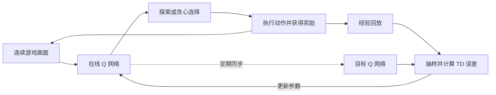

# 基于 DQN 的打砖块智能体：强化学习方法讲解

本文围绕一个问题展开：**智能体没有接球动作的标准答案，如何仅通过游戏画面和得分反馈，逐步学会控制挡板？**

我们的任务是在自制 Breakout 环境中学习接球和击砖策略。当前环境固定小球速率与挡板长度，反弹角度不随击球次数变化。采用的方法是深度 Q 网络（Deep Q-Network，DQN）。本文侧重强化学习建模、算法原理与改进思路，不讨论工程配置和运行细节。

## 1. 将打砖块建模为强化学习问题

强化学习研究智能体如何通过与环境反复交互，学习能够获得较高长期回报的行为。一次交互可以表示为：

$$
 s_t \xrightarrow{a_t} (r_t,s_{t+1})
$$

智能体观察当前状态，选择动作，环境随后产生奖励与新的状态。这里将执行动作 $a_t$ 后收到的奖励记为 $r_t$。

| 概念 | 在本项目中的含义 |
|---|---|
| 智能体 Agent | 决定挡板动作的学习系统 |
| 环境 Environment | 小球、挡板、砖块及其运动和碰撞规则 |
| 观测 Observation | 智能体看到的连续游戏画面 |
| 动作 Action | 等待、发球、向左移动、向右移动 |
| 奖励 Reward | 击碎砖块获得的游戏分数 |
| 策略 Policy | 根据当前观测选择动作的规则 |
| 回合 Episode | 从游戏开始到生命耗尽或通关的一次完整游戏 |

本项目用连续画面构成的表示作为 DQN 的输入，记为 $s_t$。它并非直接包含所有物理变量的真实状态，因此更准确地说，是对环境状态的近似表示。

智能体没有直接获得小球坐标、速度或未来落点，也没有被告知“这一帧应该向左还是向右”。它必须从交互结果中学习哪些动作更有利于未来得分。发球由环境辅助完成，主要学习目标是接球和击砖控制；不把自动发球算作智能体独立学会的能力。

## 2. 从即时奖励到长期回报

### 2.1 为什么不能只看当前是否得分

在打砖块游戏中，挡板移动通常不会立刻产生奖励。一次正确的移动可能先让挡板接住球，再经过一段飞行，才因击碎砖块获得分数。

如果只把“当前有奖励的动作”视为好动作，就难以识别那些暂时没有得分、却对后续成功至关重要的移动。这是强化学习中的**延迟奖励与信用分配问题**：如何让后来的结果影响先前动作的评价。

为此，策略优化的对象是期望折扣累计回报：

$$
G_t=\sum_{k=0}^{T-t-1}\gamma^k r_{t+k},
\qquad
J(\pi)=\mathbb{E}_{\pi}[G_0]
$$

其中，$\gamma$ 是折扣因子，控制未来奖励对当前决策的重要程度；$T$ 是回合结束时刻。折扣并不意味着忽略未来，而是给不同时间的奖励赋予不同权重。

### 2.2 本项目的奖励选择

我们直接使用击碎砖块的分数，不额外给予接球奖励、存活奖励，也不人为添加失球惩罚。这样，学习目标与游戏得分保持一致，避免智能体为了获得辅助奖励而偏离击砖目标。

没有失球负奖励，不代表智能体无法学习避免失球：失去生命通常会减少未来得分机会，这种影响可以通过长期价值体现出来。但只依靠砖块奖励，也意味着早期成功经验比较稀少，学习可能较慢。

## 3. Q-Learning：学习一个动作值多少

### 3.1 动作价值函数

Q 值不是动作概率，也不是该动作下一步一定获得的分数。它表示：**在当前状态选择某个动作后，按照某种策略继续行动，预期能获得多少折扣累计奖励。**

$$
Q^{\pi}(s,a)=\mathbb{E}_{\pi}[G_t\mid s_t=s,a_t=a]
$$

例如，当小球向左下方运动时，向左移动挡板可能提高接住球并继续得分的机会。经过学习，模型应当在这类状态下给“向左”较高的 Q 值。这个判断是学习目标，而不是人工写入模型的跟球规则。

如果能够准确知道最优动作价值 $Q^*$，就可以选择价值最大的动作：

$$
\pi^*(s)\in\arg\max_a Q^*(s,a)
$$

### 3.2 Bellman 最优关系

长期价值可以拆成“当前奖励”和“下一状态的最佳未来价值”：

$$
Q^*(s,a)=\mathbb{E}\left[r+\gamma(1-d)\max_{a'}Q^*(s',a')\mid s,a\right]
$$

其中，$d=1$ 表示真正结束，此时不再有后续回报；否则继续估计未来价值。

表格型 Q-Learning 用观察到的一次转移修正当前估计：

$$
Q(s_t,a_t)\leftarrow Q(s_t,a_t)+\alpha
\left[r_t+\gamma(1-d_t)\max_{a'}Q(s_{t+1},a')-Q(s_t,a_t)\right]
$$

方括号内是时间差分误差（Temporal-Difference Error，TD 误差）。目标值高于当前估计时，提高该动作的价值；反之则降低。由于目标使用了对下一状态价值的估计，这种学习属于 **bootstrap**，不必等整局结束后才进行更新。

## 4. DQN：用神经网络处理游戏画面

### 4.1 为什么从 Q 表转向神经网络

游戏画面包含大量像素，可能的画面组合极多，无法为每一种状态分别建立 Q 表。DQN 用神经网络 $Q_\theta(s,a)$ 近似动作价值，让不同但相似的画面共享特征和参数。

本项目属于：

- **基于价值的方法**：学习动作价值，再据此选择动作。
- **无模型的方法**：不学习或使用一个用于规划的环境转移模型。游戏自身当然仍有物理规则。
- **离策略方法（off-policy）**：可以用包含随机探索的行为所收集的经验，学习趋向于贪心选择的价值函数。

采用经典 DQN 思路，不宣称提出新的强化学习算法。[DQN 原始论文](https://www.nature.com/articles/nature14236)

### 4.2 连续帧与 CNN 各自解决什么问题

单张画面可以反映小球的位置，却通常无法区分球是向上还是向下运动。我们将连续多帧共同输入网络，使模型有机会通过位置变化判断运动趋势；图像灰度化、缩放与相邻帧处理则减少输入规模和视觉冗余。

CNN 从画面中学习与控制有关的空间特征，例如球、挡板和砖块之间的位置关系。随后，价值网络输出各离散动作的 Q 值。

可以将这条路径概括为：

**连续画面 → 视觉与运动特征 → 各动作的预计回报 → 选择动作。**

这里并不要求 CNN 显式输出球坐标，也不能仅凭得分提升就断言它已经学会精确的物理运动方程。多帧输入缓解了单帧信息不足，但不能保证完全消除部分可观测性。

## 5. DQN 的核心学习机制

### 5.1 经验回放：从过去的交互中反复学习

智能体把交互转移 $(s_t,a_t,r_t,s_{t+1},d_t)$ 存入经验回放池，再随机抽取一批经验进行学习。

这一机制主要有两个作用。首先，相邻游戏画面高度相似，连续按时间顺序训练容易使更新受近期轨迹影响；随机采样能够减弱这种相关性。其次，一次有价值的接球或击砖经历可以被多次利用，提高经验利用率。

经验回放不等于只保留成功经验。失败和低奖励转移同样有助于区分动作价值。本项目使用普通随机回放，没有加入优先经验回放；回放池也不能保证彻底避免遗忘和策略退化。

### 5.2 目标网络：降低学习目标的变化速度

如果同一个网络既产生当前 Q 值，又在每次更新时立刻改变目标中的下一状态 Q 值，模型会面对不断移动的学习目标，可能加剧训练波动。

DQN 因此维护两套网络：

| 网络 | 作用 |
|---|---|
| 在线网络 $Q_\theta$ | 估计动作价值，接收梯度更新，并用于决策 |
| 目标网络 $Q_{\theta^-}$ | 计算学习目标，间隔一段时间再从在线网络同步参数 |

目标网络不是另一个竞争的智能体，也不是取两个网络预测的平均值。它是在线网络的延迟副本，用来减缓目标变化。

### 5.3 TD 目标、损失函数与梯度更新

对于抽取的一条经验，基础的一步 DQN 使用：

$$
y_t=r_t+\gamma(1-d_t)\max_{a'}Q_{\theta^-}(s_{t+1},a'),
\qquad
\delta_t=y_t-Q_\theta(s_t,a_t)
$$

在线网络学习让其估计更接近 $y_t$，计算目标时不对目标网络反向传播。

理论讲解常用平方误差：

$$
L_{\mathrm{MSE}}(\theta)=\mathbb{E}[\delta_t^2]
$$

本项目实际采用 Huber 损失：小误差区域采用平方形式，大误差区域采用线性形式，减弱大 TD 误差对单次更新的影响。通过梯度下降方向调整在线网络参数，使一批经验上的价值估计误差减小；它并不保证每次更新后游戏得分都提高。

真正终止后，目标不再包含未来价值。若只是人为时间上限导致轨迹截断，则不能不加区分地把未来价值视为零。本项目使用现成 DQN 的目标网络、损失与优化流程，当前并未使用 Double DQN 或 Dueling 网络。[SB3 DQN 方法说明](https://stable-baselines3.readthedocs.io/en/master/modules/dqn.html)

### 5.4 ε-greedy：在尝试新动作与利用已知经验之间取舍

如果始终选择当前估计最好的动作，智能体可能因为早期错误估计而一直重复较差策略；如果始终随机动作，又无法充分利用已经学到的经验。

ε-greedy 将二者结合：

$$
a_t=\begin{cases}
\text{随机动作},&\text{概率为 }\varepsilon,\\
\arg\max_a Q_\theta(s_t,a),&\text{概率为 }1-\varepsilon.
\end{cases}
$$

训练初期进行较多探索，随着学习逐步增加对已知策略的利用；评估时采用贪心动作，观察网络本身的决策表现。因此，带探索的训练分数与贪心评估分数不是同一个统计量。

### 5.5 接球行为如何从奖励中学出来

考虑一个简化过程：智能体移动挡板接住球，随后球击中砖块，获得正奖励。

获得奖励的转移会直接提高相应动作的学习目标；在其他经验被再次抽样时，较高的后续状态价值可以通过 bootstrap 影响更早的动作估计。经过反复交互和更新，有利于延续游戏并获得更多砖块奖励的行为可能逐步得到较高评价。

这不是把后来的所有分数直接奖励给每个先前动作，也不是一次成功就能学会接球。它依赖多次样本、价值传播与神经网络泛化，存在估计误差和训练波动。

## 6. 我们如何改进已学到的策略

训练中出现过得分先提高、随后回退的现象。这个现象说明策略表现存在波动，但不能仅凭曲线确定是某个参数导致，也不能据此认定 DQN 已达到能力上限。

当前改进仍围绕 DQN 的学习过程展开：

恢复实验还尝试过 **多步回报 DQN**。一步目标只直接看到下一次奖励，多步目标则把连续几次实际奖励加入学习目标。以三步且中间未终止的情况为例：

$$
y_t^{(3)}=r_t+\gamma r_{t+1}+\gamma^2 r_{t+2}
          +\gamma^3\max_{a'}Q_{\theta^-}(s_{t+3},a')
$$

这样，击砖奖励可以直接影响更早的状态与动作，减少完全依靠逐次自举向前传播的过程。若中途真正终止，则截断奖励序列并移除终止后的自举项。多步回报仍属于 DQN，并未改变原始奖励；它也会受到轨迹随机性及采样策略与目标策略差异的影响，因此需要实测，不能保证比一步回报更好。

| 改进思路 | 希望解决的问题 | 必须注意的边界 |
|---|---|---|
| 复核多个候选策略 | 避免把最后训练得到的策略默认当成最优 | 模型选择数据仍属于开发数据 |
| 降低并逐步衰减学习率 | 尝试减小后期参数变化，保留已有有效行为 | 只能作为待验证假设，不保证避免退化 |
| 在续训中保留适度探索 | 在已有策略附近继续寻找更好的动作 | 探索过少也可能限制改进 |
| 用已有策略收集新的回放经验 | 避免续训预热阶段完全随机，获得与当前策略有关的经验 | 先收集再更新，并不等于直接复用旧经验池 |
| 延长早期经验在回放池中的保留时间 | 减少后期数据完全替换已有策略经验造成的分布变化 | 保留历史经验不等于彻底消除遗忘 |
| 采用多步回报 | 让延迟奖励更直接地影响先前动作的评价 | 更长的奖励序列也可能增加目标波动与离策略偏差 |
| 保留续训起点和历史最佳策略 | 防止后续退化时失去已有成果 | 保存较好模型不等于训练过程本身已稳定 |

这些改变不修改球速、挡板长度或奖励规则，目的是考察学习过程能否改善同一任务上的表现。恢复实验同时调整了回报跨度和经验保留方式，又增加了训练经验，因此即使分数提高，也不能把全部提升单独归因于某一个因素。

## 7. 如何判断强化学习方法是否有效

### 7.1 随机策略作为基线

随机智能体在同一环境中随机选择动作，提供不使用学习策略时的参考表现。要判断学习是否带来收益，应让随机策略和 DQN 使用相同游戏规则、评估局数和种子集合。

一局精彩的网页演示不能代替这类比较，训练时的探索分数也不能直接替代独立评估。

### 7.2 同时考察水平与稳定性

平均分反映整体得分水平，但可能被少数高分局抬高。因此我们还关注中位数、标准差、较低分位数和低分局比例，判断大多数游戏是否也有改善。

不能只看最高分，也不能认为标准差越小就越好：一个始终得零分的策略同样可以有很小的标准差。水平和波动需要一起解释。

### 7.3 区分开发评估与最终测试

开发评估用于选择模型和调整方法；最终测试应在策略选定后，使用未参与这些选择的数据进行。若反复依据同一组测试结果调参，这组数据实际上就变成了开发数据。

不同模型应尽量在相同评估协议下比较；不同游戏版本的得分不能直接作为算法优劣的证据。多个评估种子考察同一策略在不同开局下的表现，而多个训练种子还考察整个学习过程的可重复性，两者不能互相替代。

### 7.4 为什么 loss 下降不代表一定玩得更好

loss 衡量模型在抽样经验上与当前 TD 目标之间的差距，这个目标本身也依赖价值估计。游戏得分则取决于策略连续执行后形成的整条轨迹。

因此，小的价值误差、动作排序变化和经验分布变化，都可能使 loss 与实际得分呈现不同趋势。最终应通过游戏中的策略表现判断学习效果，而不是只依据损失曲线。

## 8. 汇报时应讲清楚的结论

本项目采用的是**基于图像输入的、无模型、离策略的价值学习方法 DQN**。CNN 负责从连续画面中提取特征；Q 网络评价动作的长期收益；经验回放复用交互数据；目标网络减缓目标变化；ε-greedy 平衡探索与利用；TD 学习将后续奖励逐步用于修正先前动作的价值。

我们的主要方法性工作是把游戏任务转化为可学习的状态、动作和奖励关系，并通过评估与续训研究策略的提升和波动。当前不能将阶段性高分解释为稳定通关，也不能把工程调整表述为新的强化学习算法。

答辩时，可以用以下表述概括整个方法：

> 我们让智能体通过连续画面感知游戏，通过 DQN 估计不同动作的长期回报。智能体在探索中收集经验，再利用经验回放和目标网络进行时间差分学习，逐步形成接球与击砖策略。我们通过随机基线、多局评估和候选策略复核判断学习效果，而不是仅凭一次演示或最低训练损失评价模型。
